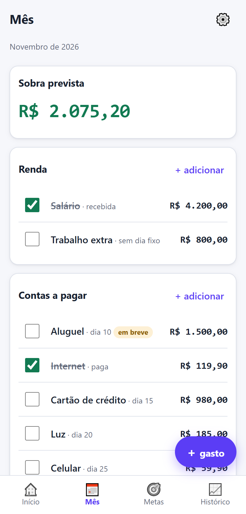
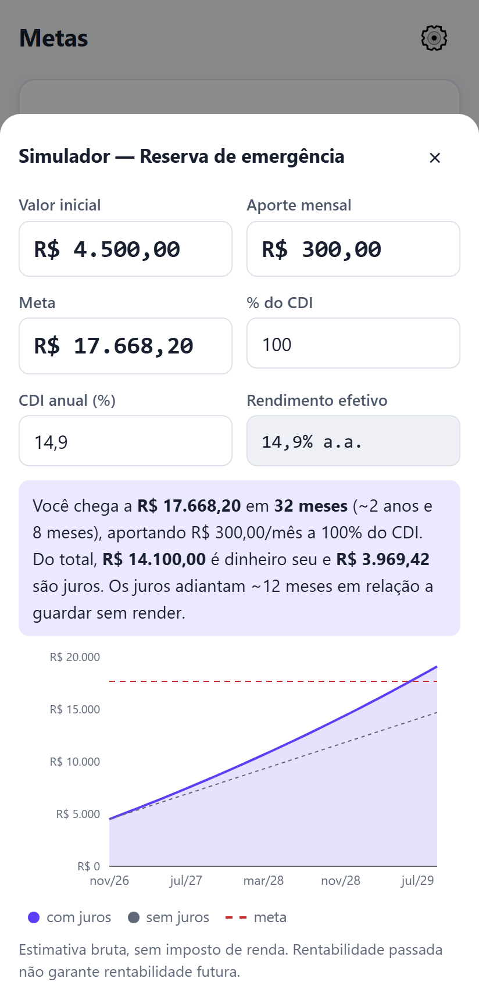
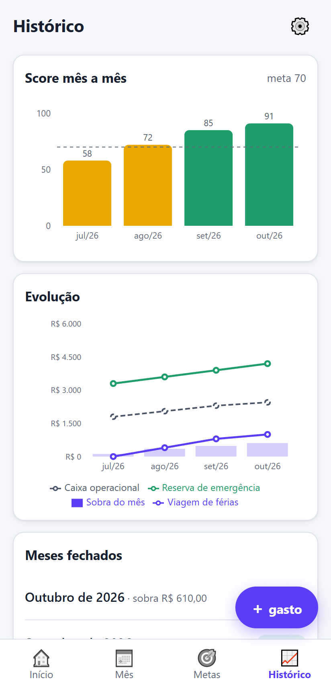

# Painel Financeiro

Painel de finanças pessoais pensado para o celular: mostra quanto vai sobrar no fim do mês, dá uma **nota de 0 a 100 para o mês** e sugere uma recompensa quando o mês foi bom. Funciona como aplicativo (instala na tela inicial do Android e do iPhone) e **sem internet**.

**Use agora:** <https://painel-financeiro-m2fm.vercel.app/>. O app abre com dados de exemplo (fictícios). Toque em "Começar com meus dados" para usar com os seus.

> 🔒 **Privacidade:** seus dados ficam só neste aparelho; o app não envia nada para fora. Não tem login, servidor nem analytics. Para levar os dados para outro aparelho, use o backup em Configurações.

| Início | Mês | Metas e simulador | Histórico |
|:---:|:---:|:---:|:---:|
|  |  |  |  |

## Para quem é

Para quem organiza o mês em torno de **renda, contas fixas, faturas, aportes e metas** (reserva de emergência, viagem, apartamento) e quer, num relance, saber se o mês está indo bem.

## O que ele faz

- **Sobra prevista do fim do mês:** quanto deve sobrar depois de pagar tudo.
- **Contas a pagar:** avisos de "vence em breve" e "atrasada" pela data de hoje.
- **Aportes e metas:** barra de progresso e prazo. A reserva de emergência calcula o próprio alvo (6× as contas).
- **Simulador de juros compostos** a partir do % do CDI de cada aplicação.
- **Parcelamentos:** quando cada um acaba e em que mês as parcelas "aliviam".
- **Gastos por categoria:** lançamento rápido em 3 toques (valor → categoria → salvar) e comparação com o mês anterior.
- **Virada de mês:** salva o resumo no histórico, desmarca o que foi pago e avança as parcelas, com opção de **desfazer**.
- **Histórico:** score mês a mês e evolução do caixa e das metas.
- **Backup:** no celular, abre a tela de compartilhar para mandar o arquivo para o Drive ou o WhatsApp (vai como `.txt`, porque o Chrome do Android não compartilha `.json`); no computador, baixa um `.json`. O importar aceita os dois.

## Como as contas funcionam

### Sobra prevista

```
sobra = caixa operacional + renda ainda não recebida − contas não pagas − aportes ainda não feitos
```

A renda só entra enquanto não foi marcada como "recebi", para não ser contada duas vezes depois que cai na conta. Aportes com dinheiro de outra pessoa ("não sai do meu bolso") não descontam.

### Score do mês (0 a 100)

| Critério | Peso | Como pontua |
|---|---|---|
| Aportes feitos | 40 | proporcional ao que foi depositado do que foi planejado |
| Contas em dia | 30 | proporcional às contas pagas até o vencimento |
| Mês no azul | 30 | sobra ≥ sobra mínima: 30 · sobra entre 0 e a mínima: 15 · sobra negativa: 0 |

- Durante o mês o score é parcial: uma conta que ainda não venceu não conta nem a favor nem contra.
- No fechamento, a nota é congelada.
- Um critério sem nenhum item (por exemplo, nenhum aporte planejado) sai da conta, e os outros são ajustados para fechar 100.
- Faixas: verde a partir de 80, amarelo de 50 a 79, vermelho abaixo de 50.
- A **sequência** (🔥) conta os meses seguidos acima da meta, que é 70 por padrão.

### Recompensa

Quando o score bate a meta, todos os aportes foram feitos e sobrou dinheiro além da sobra mínima, o app sugere separar **50% do que sobrou** (arredondado em múltiplos de R$ 10) para algo que faça bem. Para valores pequenos, sugere um jantar ou passeio. Para valores médios, um fim de semana fora. Para valores maiores, uma viagem. A outra metade pode adiantar a meta que está mais longe de ser concluída. Abaixo de R$ 100 a mensagem não aparece.

## Tecnologias

- **React + TypeScript + Vite**
- **PWA** com `vite-plugin-pwa`: instalável e funciona sem internet
- **Recharts** para os gráficos (licença MIT)
- **zod** para validar os backups
- **Vitest**: as regras de cálculo ficam em `src/regras/` como funções puras, com testes automáticos
- Publicado na **Vercel**: cada `git push` na `main` coloca uma versão nova no ar

```
src/
├── regras/       cálculos puros (projeção, score, recompensa, virada do mês...) + testes
├── dados/        tipos, validação, migrações, armazenamento, backup e dados de exemplo
├── estado/       estado do app e a data de "hoje"
├── componentes/  peças reutilizáveis (painel de baixo, campo de valor, gráficos...)
├── telas/        Início, Mês, Metas, Histórico, Configurações e formulários
└── pwa/          instalação e atualização
```

## Como rodar localmente

Precisa do [Node.js](https://nodejs.org/) (versão LTS).

```bash
npm install     # instala as dependências
npm run dev     # abre em http://localhost:5173
npm test        # roda os testes automáticos
npm run build   # gera a versão de produção em dist/
```

Os documentos de design ficam em [`docs/superpowers/`](docs/superpowers/) e o roteiro de teste manual em [`docs/teste-manual.md`](docs/teste-manual.md).
